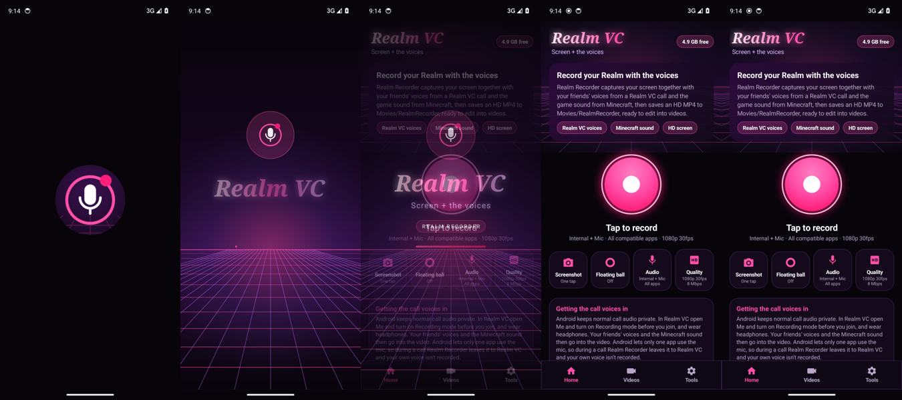
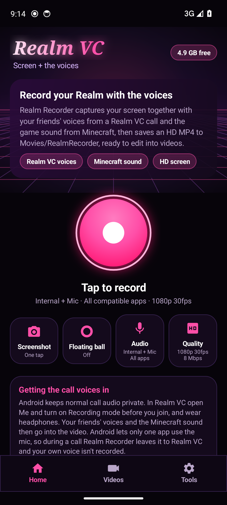
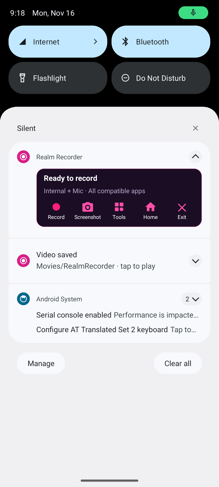
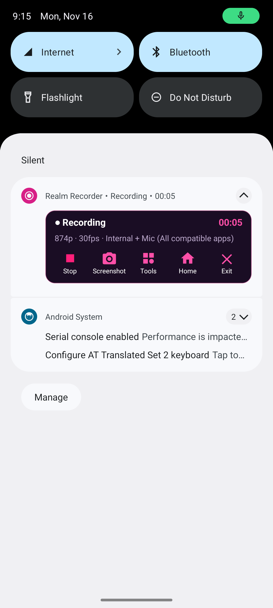

# Realm Recorder

Screen + the voices. Realm Recorder is a dark-pink Android screen recorder built for recording **Realm VC** voice calls and **Minecraft Bedrock** gameplay. It records the screen and the app audio into one MP4.



| Home | Notification toolbar | While recording |
|---|---|---|
|  |  |  |

## Download

[**Realm-Recorder.apk**](Realm-Recorder.apk): version 2.0.0, release-signed, Android 10 (API 29) or newer.

> **Uninstall any older Realm Recorder first.** Version 1.x was debug-signed, and Android won't install 2.0.0 over it because the signatures differ.

## Features

- **Home screen:**
  - storage pill;
  - big pink record button with a live timer;
  - quick tiles for Screenshot, Floating ball, Audio and Quality;
  - shortcuts that open Realm VC or Minecraft;
  - recent recordings, each with Play and Share.
- **Audio target:** Realm VC only, Minecraft only, or all compatible apps. This uses Android AudioPlaybackCapture filtered by app UID.
- **Audio mode:** Internal, Microphone, Internal + Mic (mixed), or Mute.
- **Quality:** 720p or 1080p, 30 or 60 fps, and a bitrate you choose. If your phone's encoder can't handle the size, the app automatically picks the closest size it can.
- **Notification toolbar:** Record/Stop, Screenshot, Tools, Home and Exit, plus a live timer while recording.
- **Floating ball:** needs the "display over other apps" permission. You can drag it and it snaps to the screen edge. Tap it to open Record/Stop, Screenshot, Home and Exit. It shows the timer while recording.
- **Screenshots:** you can take them while recording or on their own. They are saved to `Pictures/RealmRecorder`.
- **Where videos go:** H.264 video and AAC audio are saved to `Movies/RealmRecorder` and show up in your gallery.
- **Android 14 rules:** Android asks for screen-capture permission each time you record, and the app runs a foreground service of type mediaProjection + microphone.

## Install

1. Uninstall the old Realm Recorder if it's installed.
2. Download `Realm-Recorder.apk` on the phone and open it. Allow "install unknown apps" for your browser or file manager if asked.
3. Open Realm Recorder. Grant the notification and microphone permissions. You can also grant the overlay permission if you want the floating ball.

## Recording Realm VC calls

Android won't let any recorder capture voice-call ("communication") audio. Realm VC plays call audio as a call when echo cancellation is on, so to record a call:

1. Update **Realm VC to 1.7.0 or newer**.
2. Open **Me → Recording mode** and turn it on. This turns off echo cancellation, so call audio plays as normal media that the recorder can capture.
3. **Wear headphones.** With echo cancellation off, the others in the call would hear an echo if you use the speaker.
4. In Realm Recorder, choose audio target **Realm VC** or **All**, and mode **Internal** or **Internal + Mic**.

**Your own voice:** Android lets only one app use the microphone at a time. While Realm VC is using it for the call, Realm Recorder skips the mic, so you stay audible in the call. The recording has the other people's voices and the game audio, but not your voice.

Minecraft game audio can be captured in Internal mode. Apps that opt out of capture, such as Chrome, are recorded silent. The recorder can't get around that.

Tell everyone in a call before you record, and get their consent.

## Build

You need JDK 17+, Android SDK 34 and Gradle 8.10+.

```
export REALM_RECORDER_KEYSTORE=/path/to/keystore.properties   # storeFile, storePassword, keyAlias, keyPassword
gradle assembleRelease
```

The APK is written to `app/build/outputs/apk/release/app-release.apk`. If no keystore is configured, you get an unsigned release build.
